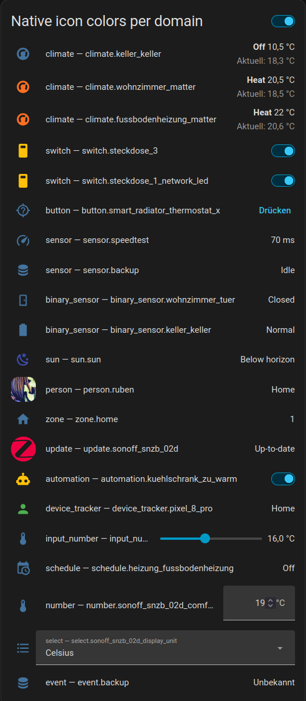
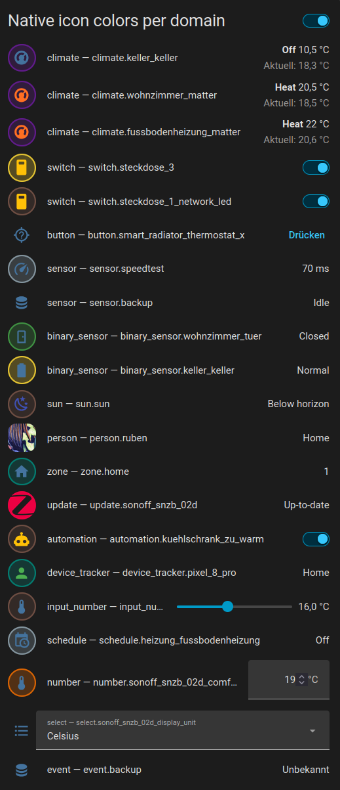
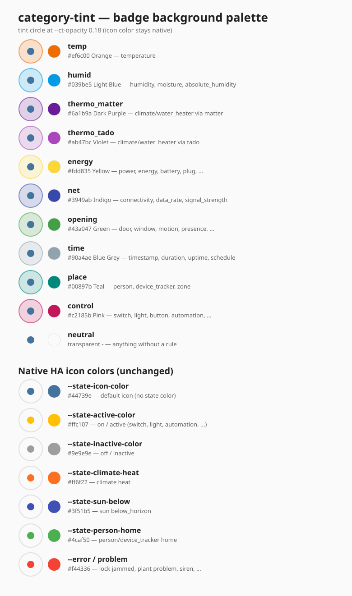
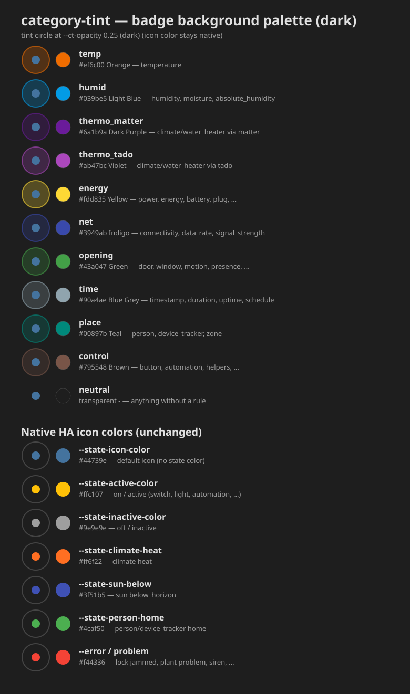
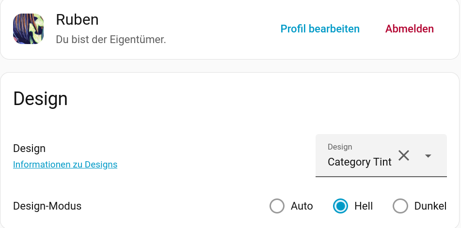

# ha-frontend-js-hack

Frontend experiments for Home Assistant, loaded via
`frontend.extra_module_url` — interim bridges until (parts of) them land
as proper features in a `ha-frontend` fork.

## category-tint.js (current approach)

Tints the **badge background circle** of state icons by entity category —
temperature, humidity, energy, network, openings, time, place, controls and
the two thermostat sources (Matter vs Tado). The icon color itself stays
100% native, so HA's state semantics (amber = on, grey = off, deep-orange =
heat, red = problem) keep their meaning. Two information channels:

```
[◍ tinted circle + colored ring = category]  icon color = state
```




Pure alpha fills over a white background always render pastel, so each
badge also gets a 2px inset ring at full color strength
(`--ct-ring-opacity`, default `0.85`) — the fill stays subtle while the
ring carries the actual color identity.

Resolution order per entity: `device_class` group → `domain` → *neutral*
(no tint). `climate`/`water_heater` resolve via the entity-registry
platform (`matter` → `thermo_matter`, everything else → `thermo_tado`).
`switch` resolves per device: config/diagnostic toggles → `control`, a
climate sibling → the thermo family, a sibling with power metering →
`energy`. Entities rendered as a picture (avatars, brand icons) stay
untinted — except round person avatars, which keep the ring.



Category list, colors and rationale: [PLAN.md](PLAN.md),
palette: [palette.svg](palette.svg) (light) / [palette-dark.svg](palette-dark.svg).

### Install

1. Copy **both** files into your HA config `www/` directory:
   `category-tint.js` and `category-tint-map.js` (the engine imports the
   map module, so both must sit side by side).
2. Register the module and theme. Add this to `configuration.yaml`
   (inside your HA config dir — the same level as `automations.yaml`).
   If a `frontend:` key already exists, merge the two parts into it —
   YAML does not allow the key twice. `/local/` is the URL alias that
   serves files from `<config>/www/`, so `/local/category-tint.js`
   resolves to `<config>/www/category-tint.js`. The `?v=` query is a
   free-form cache-buster, not a version check.

   ```yaml
   frontend:
     extra_module_url:
       - /local/category-tint.js?v=1
     themes:
       Category Tint:
         ct-enabled: "1"
         ct-opacity: "0.18"
         ct-ring-opacity: "0.85"
         ct-temp: "#ef6c00"
         ct-humid: "#039be5"
         ct-thermo-matter: "#6a1b9a"
         ct-thermo-tado: "#ab47bc"
         ct-energy: "#fdd835"
         ct-net: "#3949ab"
         ct-opening: "#43a047"
         ct-time: "#90a4ae"
         ct-place: "#00897b"
         ct-control: "#795548"
         modes:
           light:
             ct-opacity: "0.18"
           dark:
             ct-opacity: "0.25"
   ```

   The `modes` block enables the light/dark picker and lets you tune
   values per mode (a slightly stronger fill reads better on dark
   cards). Drop it if you don't care.

3. Restart HA, then select `Category Tint` under your user profile →
   Theme. The theme name is the YAML key, so rename it to taste — the
   module only looks at the `--ct-*` variables. Switching back to the
   default theme removes all tints; changing a color only needs
   `frontend.reload_themes`, not a restart.

   
4. Bump `?v=` whenever you change either JS file (browser cache).

### Tuning

- **Colors/opacity**: only the theme YAML (`ct-*` vars) — no JS changes.
- **What maps to which category**: only `category-tint-map.js`
  (`DC_MAP`, `DOMAIN_MAP`, `SWITCH_RULES`) — no engine changes.
- **Engine internals** (shadow traversal depth, which elements are
  tintable): `category-tint.js`.

## domain-icon-colors.js (v1, archived)

First iteration: injected `<style>` elements force `color`/`fill` on the
rendered SVG inside `ha-state-icon`/`state-badge` shadow roots, keyed by
entity domain to `--dic-*` theme vars. Works, but overrides the state-color
channel — superseded by the badge-tint approach. Kept for reference; theme
YAML example in git history / `PLAN.md` background section.
